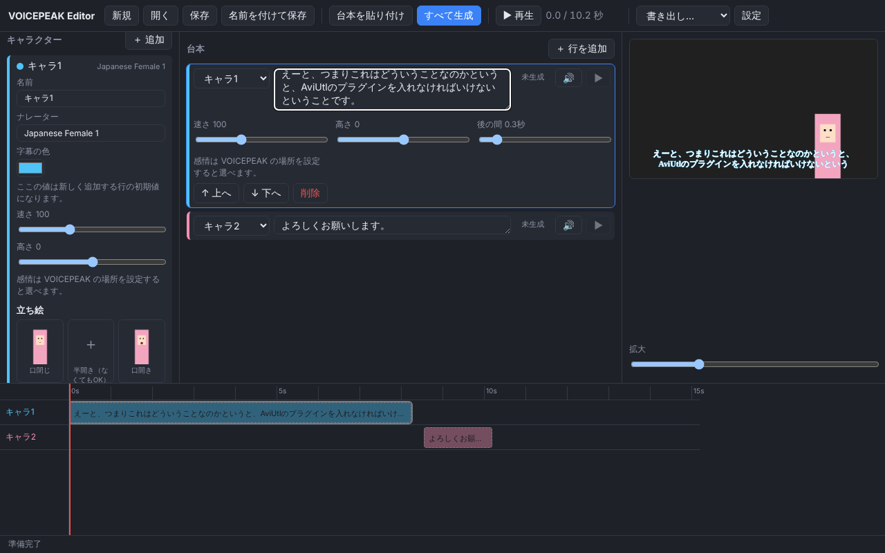

# VOICEPEAK 編集ソフト

VOICEPEAK で台本を一括読み上げし、音声と字幕をタイムラインに並べて、AviUtl 用の `.exo` や MP4 に書き出す編集ソフトです。



## できること

- キャラクターごとにナレーター・感情・速さ・高さを設定
- 台本を 1 行ずつ編集、または「名前：セリフ」形式でまとめて貼り付け
- 「すべて生成」で VOICEPEAK を呼び出して全行の音声を作成（変更した行だけ作り直し）
- 140 文字を超える行は自動で分割して生成し、1 つの音声につなげる
- タイムラインで並びを確認し、字幕つきでプレビュー再生
- 字幕の自動改行：画面幅に合わせ、助詞や句読点の前では切らずに改行。2 行を超えるセリフは複数枚に分けて、文字数に応じて表示時間を割り振る（手で入れた改行はそのまま）
- 立ち絵の口パク：キャラごとに「口閉じ」「口開き」（あれば「半開き」）の PNG を選ぶと、音声の大きさに合わせて口が動く。位置と大きさも調整可能
- 背景動画：ゲーム実況などの動画を読み込み、その上に声・字幕・立ち絵を重ねる。もとの音の大きさも調整可能
- 話し始める時刻の指定：セリフを選んで「今の再生位置にする」を押すか、タイムラインのクリップを左右にドラッグすると、その時刻から話す（次の行はそのあとに続く）
- 書き出し
  - **AviUtl（.exo）**: 背景動画・立ち絵・口パク・音声・字幕をレイヤーに配置。拡張編集にドラッグ＆ドロップで読み込めます（PSDToolKit 不要）
  - **動画（.mp4）**: 背景動画または単色＋立ち絵（口パク）＋字幕＋音声（ffmpeg が必要）
  - **音声（.wav）** / **字幕（.srt）**

## 必要なもの

- Windows 10 / 11（macOS でも動く想定）
- VOICEPEAK（`C:\Program Files\VOICEPEAK\voicepeak.exe` なら自動で見つけます）
- MP4 書き出しをする場合は [ffmpeg](https://ffmpeg.org/)

## インストールと更新

[Releases](https://github.com/nakamuraatushi25-wq/voicepeak-editor/releases/latest) から `…-setup.exe` をダウンロードして実行します。

一度入れたあとは、新しい版が出るとアプリ上部に「⬆ 新しい版 … があります」ボタンが出ます。押すとインストーラーがダウンロードされるので、アプリを閉じてから実行してください。上書きで更新され、設定・プロジェクト・生成済みの音声はそのまま残ります。

## 新しい版の出し方

1. `package.json` と `src-tauri/tauri.conf.json` の `version` を上げる（例: 0.2.0）
2. main にマージしてから `v0.2.0` のタグを push する
3. `release` ワークフローがインストーラーを Releases に公開する。アプリはそれを見て更新ボタンを出す

## 開発の始め方

[Node.js](https://nodejs.org/) 20 以上と [Rust](https://www.rust-lang.org/ja/tools/install) を入れてから:

```sh
npm install
npm run tauri dev     # 開発モードで起動
npm run tauri build   # インストーラーを作る（src-tauri/target/release/bundle/）
```

テスト:

```sh
npm test                            # 画面側（台本分割・タイムライン・exo・字幕）
cd src-tauri && cargo test          # 音声処理・VOICEPEAK 呼び出し
cargo test -- --include-ignored     # ffmpeg を使った MP4 書き出しまで（Linux/macOS）
```

## 構成

| 場所 | 中身 |
| --- | --- |
| `src/` | 画面（React + TypeScript） |
| `src/lib/exo.ts` | AviUtl `.exo` の生成 |
| `src/lib/ass.ts` | MP4 用字幕（ASS）と SRT |
| `src/lib/split.ts` | 140 文字ごとの分割 |
| `src/lib/subtitle.ts` | 字幕の自動改行とページ分け |
| `src/lib/mouth.ts` | 口パク区間の計算 |
| `src-tauri/src/voicepeak.rs` | VOICEPEAK のコマンドライン呼び出し（同時実行しないよう直列化、失敗時は再試行） |
| `src-tauri/src/audio.rs` | WAV の長さ取得・連結・ミックス、音量からの口の開き具合 |

## 注意

- VOICEPEAK のコマンドライン機能は公式マニュアルに載っていない機能です。バージョンによって動きが変わる可能性があります。
- 生成した音声はアプリのデータフォルダ（`%APPDATA%\com.voicepeak-editor.app\audio`）に保存されます。
- `.exo` は Shift_JIS で書き出します。
